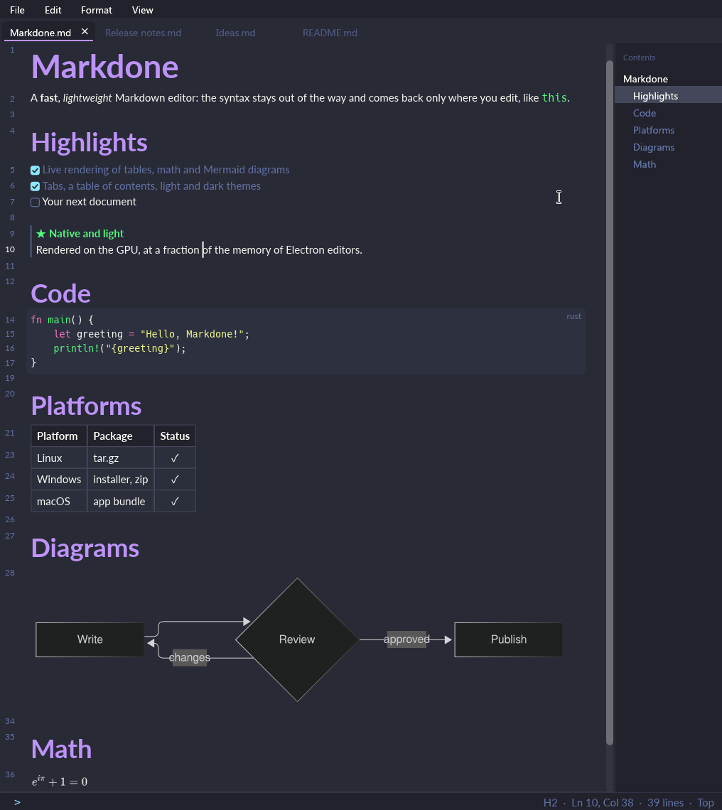
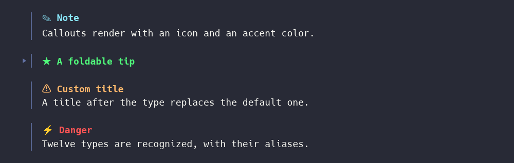
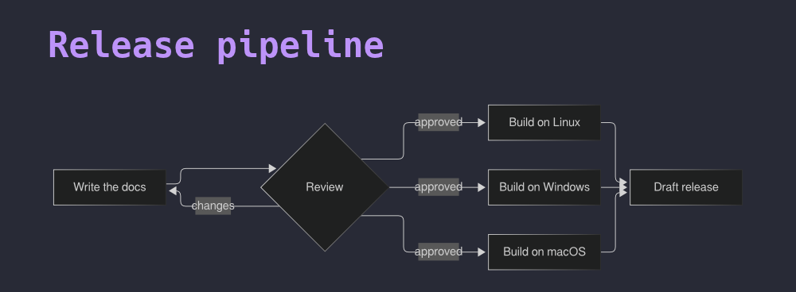
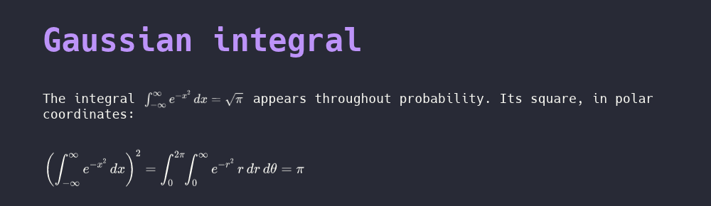
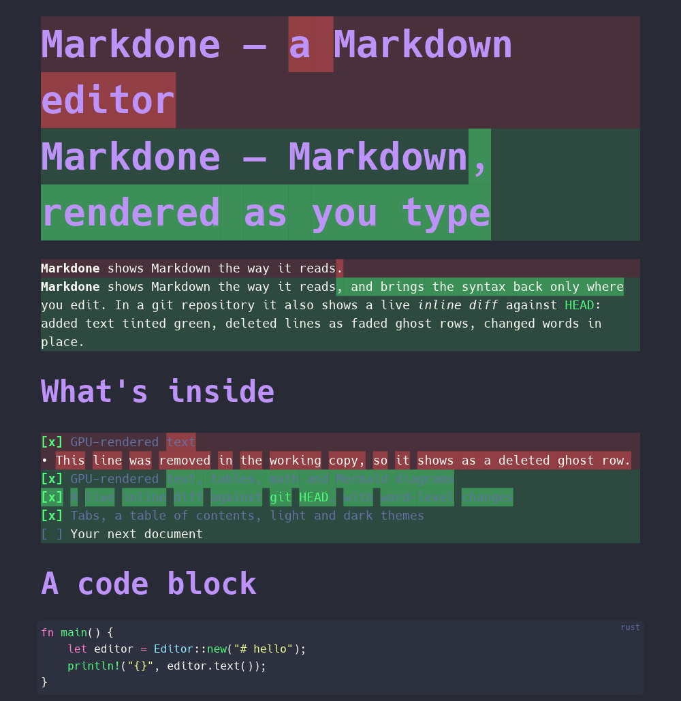

# Markdone

A fast, lightweight Markdown editor with live inline rendering: a native alternative to
Electron editors such as Zettlr, at a fraction of the memory. It runs on Linux, Windows
and macOS.

Markdone is a fork of [writ](https://github.com/wilfreddenton/writ) by Wilfred Denton
(MIT license), whose GPU document renderer and editing engine it builds on. It adds a
desktop application around them: menus, tabs, dialogs, preferences, a table of contents,
themes, PDF export, diagrams and more.



## Install

Download the archive for your system from the
[Releases](https://github.com/bitblaster/markdone/releases) page. The builds are not
signed yet, so Windows and macOS warn about them on the first launch (see below).

### Windows

- **Installer** (`markdone-…-x86_64-pc-windows-msvc-setup.exe`): installs for the current
  user (no administrator rights needed; installing for all users is offered too), adds
  Markdone to the Start menu and optionally to the desktop, and can associate `.md` and
  `.markdown` files with it. Uninstall it from *Settings → Apps*.
- **Portable** (`markdone-…-x86_64-pc-windows-msvc.zip`): unzip anywhere and run
  `markdone.exe`.

On the first launch SmartScreen may say that it protected your PC: choose *More info →
Run anyway*.

### macOS (Apple Silicon)

Unzip `markdone-…-aarch64-apple-darwin.zip` and move `Markdone.app` to *Applications*.
The app is not signed or notarized, so Gatekeeper blocks it the first time (it may even
call it "damaged"). Remove the quarantine flag the download received, then open it
normally:

```bash
xattr -dr com.apple.quarantine /Applications/Markdone.app
```

### Linux (x86_64)

Extract `markdone-…-x86_64-unknown-linux-gnu.tar.gz` and run the install script from the
extracted folder. It installs for the current user (no root needed): the binary in
`~/.local/bin`, the launcher entry and the icon in `~/.local/share`.

```bash
./install.sh             # install
./install.sh --default   # also make Markdone the default application for Markdown files
./install.sh --uninstall # remove it (the configuration and the session stay)
```

The binary needs glibc 2.35 or newer (Ubuntu 22.04, Debian 12, Fedora 36 and later). It
can also be run directly from the extracted folder, without installing.

### From source

See [Building from source](#building-from-source). On Linux,
`packaging/linux/install.sh` builds Markdone and installs it as above.

## Usage

Open Markdone from the Start menu, *Applications* or your launcher, or from a terminal:

```bash
markdone notes.md todo.md    # open these files, one tab each
markdone                     # restore the previous session (the tabs left open)
```

Markdone runs as a single instance: opening a file while it is running (from the file
manager or the command line) adds a tab to the open window. `--new-instance` starts a
separate one.

| Option | Description |
|--------|-------------|
| `FILE…` | Documents to open, one tab each |
| `--new-instance` | Start a separate instance instead of handing the files to the running one |
| `--demo` | Open a showcase document with a synthetic inline diff |
| `--config <path>` | Use this configuration file instead of the default one |
| `--github-token <token>` | GitHub API token for the GitHub references (or the `GITHUB_TOKEN` variable) |
| `--github-repo <owner/repo>` | GitHub repository for the references (default: detected from the git remote) |

Shortcuts are written with Ctrl in this document; on macOS they use Cmd, and text
navigation follows the Mac conventions (Option+arrows by word, Cmd+arrows to the line or
document ends).

## Features

### Inline rendering

Markdown syntax is hidden when the cursor is elsewhere and comes back where you edit.
Headings hide their `#` markers and display at their size, bold and italic hide their
markers, inline code hides its backticks, links hide the URL (Ctrl+click opens it). The
editor keeps a file's line endings: a Windows (CRLF) file is saved back as CRLF.

### Documents and tabs

Every document opens in a tab; the open tabs are restored at the next start, and
*File → Open Recent* lists the recent files. Files changed on disk by another program
reload after asking (or automatically, see the preferences); a document with unsaved
changes is never overwritten without asking. Files and images can be dropped on the
window.

With *Save documents automatically* (Preferences → Files) the modified documents are
saved about a second after you stop typing, and when they are closed; a new document is
saved by hand the first time, to give it a name.

The status bar shows the document's words and characters (link targets aside), and the
selection's next to them when text is selected, along with the cursor position.

### Table of contents

*View → Table of Contents* (Ctrl+Shift+O) shows the headings in a side panel: click one
to jump to it; the current section is highlighted. Drag the panel edge to resize it.

### Formatting and editing

The *Format* menu, the context menu and the shortcuts apply bold, italic, underline,
strikethrough, highlight and code, turn lines into headings, lists or quotes, and insert
links, images and code blocks. Pasting rich text (from a web page or an office suite)
converts it to Markdown; *Paste without Style* keeps the plain text, and *Copy as HTML*
copies the rendered selection.

Pasting an image (a screenshot, an image copied from another program) opens a dialog with
its preview: it is saved as a PNG file, named with the date and time unless you rename
it, in the folder the document's other images are in (or the document's own folder;
*Browse* picks another), and linked at the cursor. A document that was never saved is
saved first, so that the image has a place next to it.

Selection works with click, drag (with edge auto-scroll), Shift+arrows, double-click
(word) and triple-click (line). Undo and redo group typing into words, cursor movement
and deletion operate on whole grapheme clusters, and vertical movement keeps its column
through short lines.

### Lists, tasks and quotes

List markers become bullets, ordered lists renumber as you edit, and task lists render
checkboxes you can click. Blockquotes show a bar instead of `>`. Nesting is fully
supported.

Enter inserts a plain newline. Shift+Enter continues the current list or quote
(`- item` → a new `- `), Shift+Alt+Enter adds an indented continuation paragraph. Tab
cycles through the nesting states that fit the context (sibling item, paragraph indent,
nested item); Shift+Tab goes back.

### Callouts

Obsidian-style callouts (`> [!note]`, `tip`, `warning`, `danger` and the other types,
with their aliases) render with an icon and an accent color. A custom title can follow
the type, and `+`/`-` after it (`> [!tip]-`) makes the callout foldable.



### Footnotes

Footnote references (`text[^1]`) show as superscript numbers (other labels in brackets),
and the definitions (`[^1]: the note`) as the number and the note. Hovering a reference
shows its note; Ctrl+click jumps from a reference to its note and from a note back to
where it is referenced. *Format → Insert → Footnote* adds the next number at the cursor
and its definition at the end of the document, with the cursor there to write it.

### Code blocks

Fenced code blocks are shown as panels with their language in the corner; the fences come
back when the cursor enters the block. Syntax highlighting covers Rust, Python, Java,
JavaScript, TypeScript, C, C++, PHP and shell (`bash`/`sh`), plus Mermaid and LaTeX
sources. In a code block Tab indents.

### Tables

Pipe tables render as a grid with a bold header, column alignment (`:--`, `:-:`, `--:`)
and inline styles in the cells, and stay a grid while you edit them, as in a word
processor: the cell with the cursor shows its Markdown source, the arrows move within and
between cells, Tab goes to the next cell (adding a row after the last one) and Enter to the
cell below. A `|` typed in a cell is escaped, so it can't split the table. Columns keep
their header on one line whenever the table fits. The context menu's *Table* submenu
clears or deletes the table, inserts and deletes rows and columns, and aligns a column;
it rewrites the table with its columns lined up in the source. Type a header row such as
`| Name | Age |` and press Shift+Enter to add the delimiter and a body row.

### Mermaid diagrams

` ```mermaid ` blocks render as diagrams, drawn as vectors (sharp at any window scale),
off the UI thread. They are laid out by [merman](https://github.com/Latias94/merman), a
Rust port of Mermaid 12, so they match what Mermaid itself (and Zettlr) draw: flowcharts
use Mermaid's default ELK layout, and `%%{init: {"layout": "dagre"}}%%` or other `init`
options (such as `theme`) are honoured. Diagrams follow the light or dark theme; the PDF
export uses Mermaid's light theme. Moving the cursor into the block shows its source.



### Math

LaTeX math renders with [RaTeX](https://github.com/erweixin/RaTeX) and the KaTeX fonts:
`$$…$$` as centered display math, `$…$` inline on the text baseline (prose such as "$5 and
$10" stays literal). The source comes back when the cursor enters it.



### Inline git diff

In a git repository, Markdone shows the changes since the last commit inline: added lines
and words tinted green, deleted lines as faded ghost rows above their position, all
rendered as Markdown. The diff follows edits, external changes and commits or branch
switches live. *View → Git Differences* turns it off.



### Spell checking

With *Check spelling* on (Preferences → Spelling, off by default), misspelled words are
underlined with a wavy line, in any combination of languages (English, Italian, French,
German, Spanish, Portuguese, Dutch): a word is right if one of the checked languages
accepts it, so mixed-language documents work. Code, links' targets, URLs, math and
footnote markers are not checked, nor is the word being typed. Right-click an underlined
word for suggestions, or to add it to your personal dictionary (`dictionary.txt` next to
the configuration file).

On Linux the dictionaries installed with the system (`hunspell-*` packages) are used.
A language the system does not have, and every language on Windows and macOS, is
downloaded from [LibreOffice's dictionaries](https://github.com/LibreOffice/dictionaries)
the first time it is checked, and kept in the user data folder. Checking is done by
[spellbook](https://github.com/helix-editor/spellbook), which reads Hunspell dictionaries.

### Find and replace

Ctrl+F opens the find bar, Ctrl+H adds the replace field. Matches highlight live with a
count; Enter and Shift+Enter move between them. Regular expressions (Alt+R, with `$1`
groups in the replacement) and case sensitivity (Alt+C) can be toggled; Ctrl+Enter
replaces all matches in one undo step.

### Folding

Headings, nested lists and foldable callouts fold from the margin: hover it to reveal a
chevron and click to collapse the section. Ctrl+click folds every section at that level,
Shift+click folds recursively, Ctrl+Shift+click folds that level and the deeper ones.
Ctrl+Shift+1…6 folds every heading at that depth.

### PDF export

*File → Export as PDF* (Ctrl+E) prints the document, with its images, diagrams and math,
through an installed Chromium-family browser (Chrome, Chromium, Edge or Brave), which
must be present.

### Appearance

- **Light and dark modes**, each with its own theme, switched with *View → Dark Mode* or
  automatically following the system setting (on Linux through the XDG desktop portal,
  supported by KDE, GNOME and others). Built-in themes: dark `dracula`, `nord`,
  `solarized-dark`, `gruvbox-dark`, `tokyo-night`, `catppuccin-mocha`; light
  `solarized-light`, `catppuccin-latte`; custom themes can be defined in the
  configuration file.
- **Fonts**: any installed font for the text, a monospace font for the code.
- **Zoom**: Ctrl+plus, Ctrl+minus, Ctrl+0 or Ctrl+wheel.
- Text width (limited or the whole window), line numbers.

### GitHub references

Optionally (*Preferences → Privacy*, off by default), in a GitHub repository Markdone
recognizes `#123` issues and pull requests, `@user` mentions and `owner/repo#456`
references. With a GitHub token (set in the same preferences section, or with
`--github-token` or the `GITHUB_TOKEN` variable, which take precedence) it checks them
against the GitHub API: valid ones are colored and show a card on hover, and typing `#`
or `@` offers completions; Ctrl+R revalidates them. The token in the preferences is
stored in plain text in the configuration file.

## Configuration

*Edit → Preferences* changes the settings and saves them immediately to `config.toml`:

| System | Location |
|--------|----------|
| Linux | `~/.config/markdone/config.toml` |
| Windows | `%APPDATA%\markdone\config.toml` |
| macOS | `~/Library/Application Support/markdone/config.toml` |

The file can also be edited by hand (Markdone keeps your comments when it saves);
[`config.example.toml`](config.example.toml) documents every key. Custom themes live only
there:

```toml
[theme]
dark = "my-midnight"      # the theme of dark mode
light = "catppuccin-latte"

[themes.my-midnight]      # colors omitted here are inherited from dracula
background = "#0B0E14"
foreground = "#BFBDB6"
```

## Building from source

Requirements: Rust (stable, 1.95 or newer) and a C compiler (for the syntax grammars).

- **Linux**: `libwayland-dev` and `libxkbcommon-dev` (Debian/Ubuntu names); fontconfig is
  loaded at runtime.
- **Windows**: the Visual Studio Build Tools (MSVC).
- **macOS**: the Xcode Command Line Tools.

```bash
git clone https://github.com/bitblaster/markdone
cd markdone
cargo run --release -- notes.md
```

Build profiles:

- **dev** (`cargo run`): dependencies optimized, Markdone's own code unoptimized and
  debuggable, so a debug build is still comfortable to use.
- **release**: thin LTO, a single codegen unit, stripped symbols, and the Mermaid renderer
  optimized for size; the slowest to build.
- **release-fast** (`cargo build --profile release-fast`): release optimizations without
  LTO, for quicker builds while trying changes.

`cargo test` runs the tests (the `github::` ones call the GitHub API and need
`GITHUB_TOKEN`; skip them with `cargo test -- --skip github::`). CI runs formatting,
clippy and the tests on Linux, Windows and macOS. Pushing a `vX.Y.Z` tag that matches the
version in `Cargo.toml` builds the release archives and the Windows installer and drafts a
GitHub Release.

Diagnostics: `MARKDONE_PROFILE=1` logs frame, rebuild and diagram render times;
`MARKDONE_SCROLL_TRACE=1` logs scrolling and layout; `MARKDONE_WINDOW_SIZE=1100x700` sets
the initial window size (for screenshots). On Linux/Mesa systems such as Asahi,
`WGPU_BACKEND=vulkan` selects the Vulkan backend.

## Architecture

The document is drawn with [winit](https://github.com/rust-windowing/winit),
[wgpu](https://wgpu.rs), [Vello](https://github.com/linebender/vello) (GPU 2D rendering)
and [Parley](https://github.com/linebender/parley) (text layout); the menus, dialogs and
panels are drawn with [egui](https://github.com/emilk/egui) on top.

The buffer stores the raw Markdown in a rope (ropey), and tree-sitter reparses it
incrementally on every edit: only the changed region is reparsed, so editing a
10,000-line document feels like editing a short one. Tree-sitter-md produces a block tree
(paragraphs, headings, lists, code blocks) and an inline tree per paragraph (emphasis,
links), walked through a unified cursor.

Each line carries the markers of its block syntax (a task item in a blockquote has
`[Checkbox, BlockQuote]`), each knowing the bytes to hide when the cursor is away, its
visual substitution (`-` becomes `•`) and its continuation for Shift+Enter. Lines are laid
out independently with Parley, hiding or showing markers depending on the cursor; a
per-line map between the displayed text and the buffer offsets keeps cursor placement,
hit-testing and diff highlights aligned.

Layout is virtualized: only the lines in and around the viewport are laid out, the rest
are height-estimated (text, tables and diagrams at their expected size), and the scroll
position is pinned to a line, so off-screen corrections never move what is on screen.

Code blocks are highlighted with tree-sitter-highlight, one grammar per language, block by
block; highlights are cached and recomputed after edits. Mermaid diagrams are rendered to
SVG by merman and recorded once into a Vello scene fragment, drawn as vectors.

## Limitations

- Markdone draws with the GPU, so it needs a graphics driver with DirectX 12 (Windows),
  Metal (macOS) or Vulkan. Without one, as in a virtual machine without 3D acceleration,
  it falls back to a software renderer and becomes very slow.
- Only ATX headings (`# Heading`) are recognized; setext headings (a line underlined with
  `===` or `---`) render as plain text.
- macOS: opening a document from Finder (double-click, *Open With*) does not pass it to
  Markdone yet; use *File → Open*, drag it on the window, or the command line.

## License

Markdone is released under the MIT license (see [LICENSE](LICENSE)), like writ, from which
it is forked.

The Mermaid renderer included in the builds brings third-party code under other licenses:

- [merman](https://github.com/Latias94/merman): MIT or Apache-2.0.
- `merman-elk-layered`, merman's Rust port of the layered algorithm of the
  [Eclipse Layout Kernel (ELK)](https://github.com/eclipse-elk/elk), which lays out
  flowcharts the way Mermaid 12 does by default: **Eclipse Public License 2.0**
  ([text](https://www.eclipse.org/legal/epl-2.0/)). EPL-2.0 is a weak, file-level
  copyleft: it covers that crate's own files, not the rest of Markdone. Its source is
  published on [crates.io](https://crates.io/crates/merman-elk-layered) and in the
  [merman repository](https://github.com/Latias94/merman); see merman's
  [THIRD_PARTY_NOTICES.md](https://github.com/Latias94/merman/blob/main/THIRD_PARTY_NOTICES.md)
  for the obligations that apply when distributing binaries.

The spell checker, [spellbook](https://github.com/helix-editor/spellbook), is under the
**Mozilla Public License 2.0** ([text](https://www.mozilla.org/MPL/2.0/)), also a
file-level copyleft that covers only that crate's own files, whose source is published on
[crates.io](https://crates.io/crates/spellbook). The dictionaries are not part of
Markdone: they come from the system, or are downloaded from LibreOffice's repository
under their own licenses (see the README of each language there).
